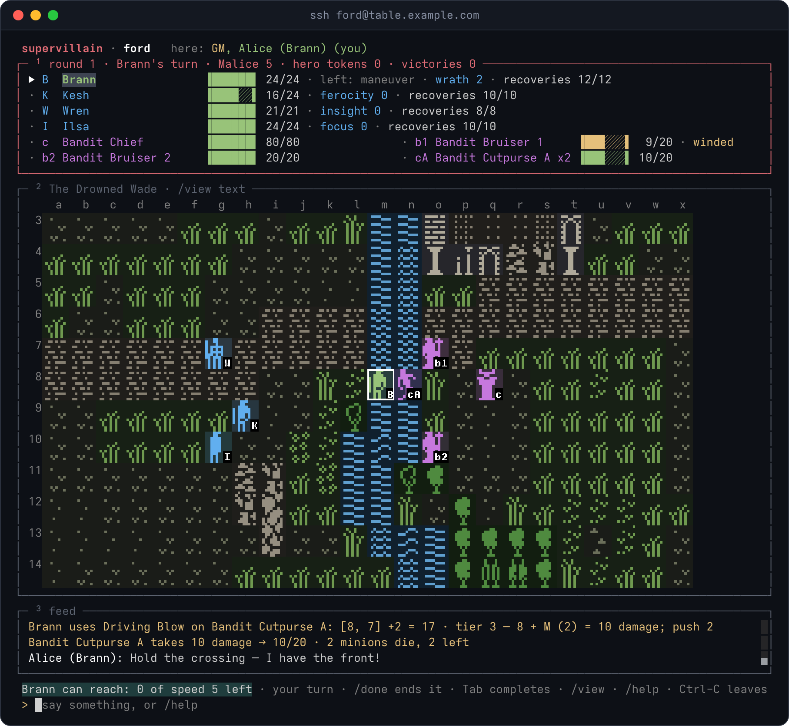

# supervillain

A virtual tabletop for TTRPGs that runs in your terminal over SSH. Players sit down with one command (`ssh <room>@<host>`)—nothing to install and no account to make—while the GM runs the table from their own machine and owns the campaign as plain local files.



- **Three rulesets out of the box:** Draw Steel (default), `set.world`, and PF2e Remaster under the ORC License (`rules: pf2e`)—sharing one tactical grid (text or kitty-graphics pictures), click-to-act mouse menus, `/undo`, and a GM prep panel.
- **The GM's machine is the authority:** Your campaign is a plain folder of YAML sheets, text maps, and an append-only `events.jsonl` log on disk.
- **No accounts:** Your SSH key is your identity (or join without one as a guest).
- **Play anywhere:** Host over LAN/Tailscale, a TCP tunnel, or `supervillain relay` on a small Linux VPS with a built-in lobby.

## Quick start

**Host a table** (with the sample Draw Steel encounter):

```sh
supervillain new ~/campaigns/ford --example
supervillain host ~/campaigns/ford
```

**Join as a player** (players need only `ssh`):

```sh
ssh -p 2222 ford@127.0.0.1
```

Plain text is chat, `/` runs commands, `Tab` completes, `/help` lists everything, and `Ctrl-C` leaves. To try another ruleset, pass `--rules set-world` or `--rules pf2e` to `supervillain new`.

## Install

- **Release binary:** Download the self-contained executable for Linux or macOS (`x64` / `arm64`) and `SHA256SUMS` from GitHub Releases—see [docs/HOSTING.md](docs/HOSTING.md#install).
- **From source:** Install [Bun](https://bun.sh) 1.4.5+, run `bun install`, then `bun supervillain …` from the repo root.

## Guides

- [docs/PLAYING.md](docs/PLAYING.md) — player guide (keyboard, mouse, commands, lobby)
- [docs/HOSTING.md](docs/HOSTING.md) — hosting, relay setup, and automated deploys
- [docs/rulesets/](docs/rulesets/) — [Draw Steel](docs/rulesets/draw-steel.md), [set.world](docs/rulesets/set-world.md), [PF2e Remaster (ORC)](docs/rulesets/pf2e.md)
- [docs/how-it-works.md](docs/how-it-works.md) — architecture, invariants, and [ADRs](docs/adr/)

## Develop

Requires [Bun](https://bun.sh) 1.4.5+ and Node 26+ (for `oxlint.config.ts` and `.ts` lint plugins).

```sh
bun install
bun run fmt            # format with oxfmt
bun run check          # oxfmt --check, strict oxlint, zero-comment check, and tsc -b
bun run build          # tsc -b across all workspaces
bun run test           # run the full test suite in parallel (or `bun test`)
bun run release:build  # compile dist/supervillain-<os>-<arch> (--all for every platform)
bun run release:smoke dist/supervillain-linux-x64
```

- **CI & site CD:** Pushing to `main` runs `.github/workflows/ci.yml` and automatically deploys `packages/site` to Cloudflare via `.github/workflows/site-deploy.yml` when `packages/site/**` changes.
- **Releases & relay CD:** Pushing a stable `v*` tag runs `.github/workflows/release.yml` (check, full tests, 4-platform binaries, 3-platform TTY smoke tests, `SHA256SUMS`, SLSA attestation, GitHub Release) and automatically upgrades the relay VPS via `.github/workflows/relay-deploy.yml` and `scripts/deploy-relay.sh`.

See [AGENTS.md](AGENTS.md) for workspace layout and engineering rules.

## License & Notices

[MIT](LICENSE). See [NOTICE](NOTICE) for third-party attributions and [docs/ORC-NOTICE.md](docs/ORC-NOTICE.md) for the Open RPG Creative (ORC) License notice covering the `pf2e` ruleset.

---

supervillain is an independent product published under the DRAW STEEL Creator License and is not affiliated with MCDM Productions, LLC. DRAW STEEL © 2024 MCDM Productions, LLC.
